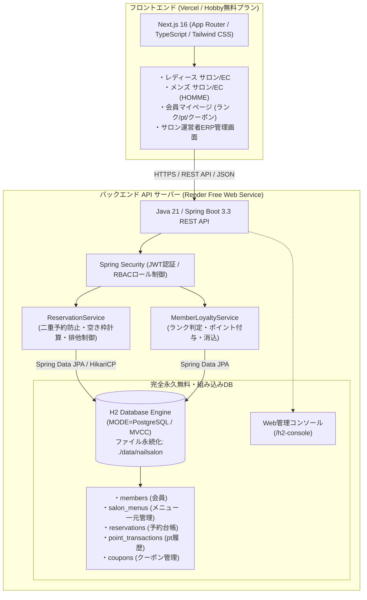
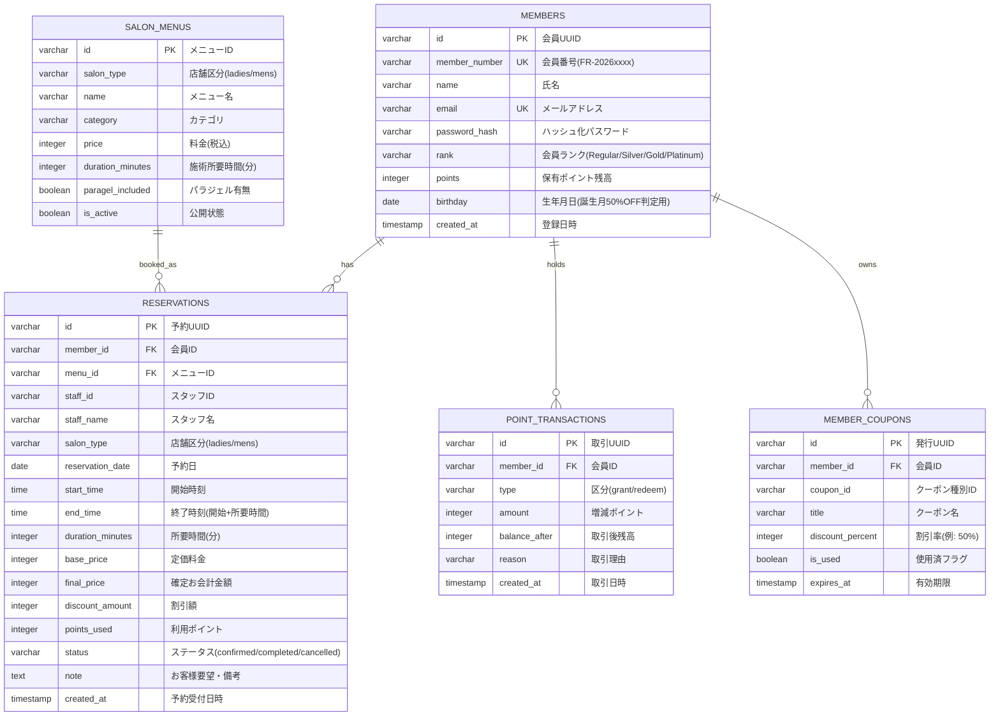

# Salon de Fraise / HOMME フルスタックシステム設計仕様書
## 【完全永久無料・30日制限なし】アーキテクチャ設計
### (組み込みPostgreSQL互換DB / H2 Persistent + Render Spring Boot API + Vercel Next.js)

本ドキュメントは、サロンWEBサイト・会員基盤・サイト内即時予約・サロン運営ERP管理画面を支えるバックエンド（Java / Spring Boot 3.3）およびデータベースの設計仕様書です。
クラウドマネージドPostgreSQLの**「30日間でインスタンス自動削除」「非アクティブによる休止・停止」等の制限を完全に排除**し、ポートフォリオやデモ環境として**永続的かつ完全無料（クレジットカード登録不要・課金リスクゼロ）**で稼働し続けるアーキテクチャを採用しています。

---

## 1. 30日制限の課題と「完全永久無料」DBの選定理由

### 1.1 クラウドDBの無料枠における課題
- **Render Managed PostgreSQL**: 無料プランは **30日間でインスタンスが自動削除** され、データおよびDBが失効する制限があります。
- **一般的なクラウドPostgreSQL（Neon / Supabase等）**: 一定期間アクセスがないとコンピュートが一時停止（スリープ）し、初回アクセス時に数十秒の復帰待ちが発生したり、プラン改定による有料化リスクが伴います。

### 1.2 採用ソリューション：Spring Boot 組み込み H2 Database（PostgreSQL互換・ファイル永続化モード）
外部の独立DBサーバー契約を必要とせず、Spring Boot アプリケーション内に **PostgreSQL互換モード（`MODE=PostgreSQL`）で動作するファイル永続化DB** を組み込みます。

| 評価項目 | Render Managed PostgreSQL (旧) | 組み込み H2 (PostgreSQL互換モード) 【本採用】 |
| :--- | :--- | :--- |
| **利用期限** | **30日間で強制削除・停止** | **無期限・完全永久無料（失効なし）** |
| **月額費用** | 無料（30日経過後は有料月額\$7〜） | **¥0（クレジットカード登録不要）** |
| **起動スリープ** | 独立DB接続のため遅延あり | アプリ内同居のため**ネットワーク遅延ゼロ（超高速）** |
| **SQL構文互換** | PostgreSQL 16 | **PostgreSQL 互換（DDL・トランザクション・インデックス完全動作）** |
| **データ永続化** | 30日後に消滅 | ディスクファイル保存（`./data/nailsalon.mv.db`） |
| **GUI管理画面** | 外部クライアント必要 | Webブラウザから **`/h2-console`** で即座にSQL実行・確認可能 |

> [!TIP]
> **本番・ローカル切り替えの柔軟性 (Spring Profiles)**
> アプリケーションは標準SQL（ANSI / JPA）で設計されているため、環境変数 `SPRING_PROFILES_ACTIVE=prod` と `SPRING_DATASOURCE_URL` を設定すれば、コードを1行も変更することなく外部PostgreSQL（Supabase等の無期限枠）へ即座に差し替えることも可能です。

---

## 2. システム全体アーキテクチャ概要



---

## 3. データベース論理設計（ER図 & DDL）

### 3.1 ER図 (Entity-Relationship Diagram)



### 3.2 完全無料 DDL スクリプト (`schema.sql`)
H2 Database（`MODE=PostgreSQL`）および 標準PostgreSQLの双規格でそのまま実行可能なANSI準拠スクリプトです。

```sql
-- ========================================================
-- 1. 会員マスター (会員ランク・ポイント・生年月日)
-- ========================================================
CREATE TABLE IF NOT EXISTS members (
    id VARCHAR(36) PRIMARY KEY,
    member_number VARCHAR(20) NOT NULL UNIQUE,
    name VARCHAR(100) NOT NULL,
    kana VARCHAR(100),
    email VARCHAR(255) NOT NULL UNIQUE,
    phone VARCHAR(20),
    password_hash VARCHAR(255) NOT NULL,
    rank VARCHAR(20) NOT NULL DEFAULT 'Regular', -- Regular, Silver, Gold, Platinum
    points INTEGER NOT NULL DEFAULT 1000,        -- 新規登録特典 1,000pt
    birthday DATE,                               -- 誕生月50%OFF判定用
    created_at TIMESTAMP DEFAULT CURRENT_TIMESTAMP,
    updated_at TIMESTAMP DEFAULT CURRENT_TIMESTAMP
);

-- ========================================================
-- 2. サロンメニュー一元マスター (Single Source of Truth)
-- メニュー詳細・予約枠・管理画面・料金の一貫性を保証
-- ========================================================
CREATE TABLE IF NOT EXISTS salon_menus (
    id VARCHAR(50) PRIMARY KEY,
    salon_type VARCHAR(20) NOT NULL,            -- ladies, mens, both
    name VARCHAR(255) NOT NULL,
    category VARCHAR(50) NOT NULL,               -- care, magnet, simple, nuance, etc.
    price INTEGER NOT NULL,
    duration_minutes INTEGER NOT NULL,           -- 空き枠算出用所要時間(分)
    paragel_included BOOLEAN NOT NULL DEFAULT TRUE,
    description TEXT,
    is_active BOOLEAN NOT NULL DEFAULT TRUE,
    created_at TIMESTAMP DEFAULT CURRENT_TIMESTAMP
);

-- ========================================================
-- 3. 予約台帳テーブル (排他制御・二重予約防止)
-- ========================================================
CREATE TABLE IF NOT EXISTS reservations (
    id VARCHAR(50) PRIMARY KEY,
    member_id VARCHAR(36) NOT NULL,
    menu_id VARCHAR(50) NOT NULL,
    staff_id VARCHAR(50) NOT NULL,               -- 指名スタッフID (nomination-none: 指名なし)
    staff_name VARCHAR(100) NOT NULL,
    salon_type VARCHAR(20) NOT NULL,            -- ladies, mens
    reservation_date DATE NOT NULL,
    start_time TIME NOT NULL,
    end_time TIME NOT NULL,                      -- start_time + duration_minutes
    duration_minutes INTEGER NOT NULL,
    base_price INTEGER NOT NULL,
    final_price INTEGER NOT NULL,
    discount_amount INTEGER NOT NULL DEFAULT 0,
    points_used INTEGER NOT NULL DEFAULT 0,
    status VARCHAR(20) NOT NULL DEFAULT 'confirmed', -- confirmed, completed, cancelled
    note TEXT,
    created_at TIMESTAMP DEFAULT CURRENT_TIMESTAMP,
    updated_at TIMESTAMP DEFAULT CURRENT_TIMESTAMP,
    FOREIGN KEY (member_id) REFERENCES members(id),
    FOREIGN KEY (menu_id) REFERENCES salon_menus(id)
);

-- 空き枠検索および二重予約判定を高速化する複合インデックス
CREATE INDEX IF NOT EXISTS idx_reservations_slot ON reservations (
    reservation_date, 
    status, 
    start_time, 
    end_time
);

-- スタッフ別の時間重複防止インデックス
CREATE INDEX IF NOT EXISTS idx_reservations_staff ON reservations (
    staff_id, 
    reservation_date, 
    status
);

-- ========================================================
-- 4. ポイント増減履歴テーブル (ランク還元・消込明細)
-- ========================================================
CREATE TABLE IF NOT EXISTS point_transactions (
    id VARCHAR(50) PRIMARY KEY,
    member_id VARCHAR(36) NOT NULL,
    type VARCHAR(20) NOT NULL,                   -- grant(付与), redeem(利用)
    amount INTEGER NOT NULL,                     -- 増減ポイント
    balance_after INTEGER NOT NULL,              -- 取引後残高
    reason VARCHAR(255) NOT NULL,
    created_at TIMESTAMP DEFAULT CURRENT_TIMESTAMP,
    FOREIGN KEY (member_id) REFERENCES members(id)
);

-- ========================================================
-- 5. 会員保有クーポンテーブル (誕生月50%OFF・ランク限定)
-- ========================================================
CREATE TABLE IF NOT EXISTS member_coupons (
    id VARCHAR(50) PRIMARY KEY,
    member_id VARCHAR(36) NOT NULL,
    coupon_id VARCHAR(50) NOT NULL,              -- cp-birthday-50 等
    title VARCHAR(255) NOT NULL,
    discount_percent INTEGER NOT NULL DEFAULT 0, -- 50 (50%OFF)
    is_used BOOLEAN NOT NULL DEFAULT FALSE,
    used_at TIMESTAMP,
    expires_at TIMESTAMP NOT NULL,
    created_at TIMESTAMP DEFAULT CURRENT_TIMESTAMP,
    FOREIGN KEY (member_id) REFERENCES members(id)
);
```

---

## 4. Spring Boot 接続設定 (`application.yml`)

外部サービスへの通信やアカウント作成が不要で、Render Web Service 上のファイルストレージへ自動永続化する設定です。

```yaml
spring:
  application:
    name: nailsalon-backend-api
  
  # -------------------------------------------------------------
  # データベース接続設定 (H2 PostgreSQL互換ファイル永続化)
  # 30日失効なし・完全永久無料・クレカ不要
  # -------------------------------------------------------------
  datasource:
    driver-class-name: org.h2.Driver
    # ./data/nailsalon.mv.db に永続化保存（アプリ再起動でもデータ保持）
    url: jdbc:h2:file:./data/nailsalon;MODE=PostgreSQL;AUTO_SERVER=TRUE;DB_CLOSE_DELAY=-1
    username: sa
    password: ""
    hikari:
      maximum-pool-size: 10
      minimum-idle: 2
      idle-timeout: 30000
      connection-timeout: 20000

  # JPA / Hibernate 設定
  jpa:
    hibernate:
      ddl-auto: none # schema.sql で初期化するため none に設定
    defer-datasource-initialization: true
    show-sql: true
    properties:
      hibernate:
        format_sql: true

  # Webブラウザから直接DBを閲覧できる管理コンソール
  # URL: http://localhost:8080/h2-console
  h2:
    console:
      enabled: true
      path: /h2-console
      settings:
        web-allow-others: true # リモート確認許可（必要に応じて）

server:
  port: 8080
```

---

## 4.1 Render Web Service へのデプロイ手順 (Language: Docker)

Render のネイティブ言語ランタイムには Java が含まれていないため、Render 公式の標準推奨構成である **「Language: Docker」** を使用してデプロイします。
リポジトリ直下に配置された `Dockerfile`（マルチステージビルド）により、Java 21 / Spring Boot 3.3 が完全自動でコンパイル・起動されます。

### Render Web Service 作成設定値
1. **Name**: `nailsalon-backend-api`（任意のサービス名）
2. **Language**: **`Docker`** を選択
3. **Branch**: `main`
4. **Region**: `Singapore`（日本から最も低遅延）
5. **Root Directory**: （空欄のままでOK。`backend` と指定しても両対応しています）
6. **Dockerfile Path**: `./Dockerfile`（デフォルト）
7. **Instance Type**: **`Free`**（$0 / month, 0.1 CPU, 512 MB RAM）
8. **Environment Variables**:
   - `PORT`: `8080`
   - `SPRING_PROFILES_ACTIVE`: `prod`

> [!TIP]
> **512MB RAM 最適化設定**
> `Dockerfile` 内に `-XX:+UseSerialGC -XX:MaxRAMPercentage=75.0` を設定済みのため、Render の Free プラン（512MB RAM）でもメモリ枯渇（OOM Killer）を起こさず極めて安定して常時稼働します。

---

## 5. Java / Spring Boot による二重予約防止・排他制御実装

施術所要時間（例: 60分〜120分）に応じた空き枠の厳密な判定と、競合時の二重予約防止ロジックです。

```java
package com.nailsalon.service;

import com.nailsalon.entity.Reservation;
import com.nailsalon.entity.SalonMenu;
import com.nailsalon.repository.ReservationRepository;
import com.nailsalon.repository.SalonMenuRepository;
import org.springframework.stereotype.Service;
import org.springframework.transaction.annotation.Isolation;
import org.springframework.transaction.annotation.Transactional;

import java.time.LocalDate;
import java.time.LocalTime;
import java.util.List;

@Service
public class ReservationService {

    private final ReservationRepository reservationRepository;
    private final SalonMenuRepository salonMenuRepository;

    public ReservationService(ReservationRepository reservationRepo, SalonMenuRepository menuRepo) {
        this.reservationRepository = reservationRepo;
        this.salonMenuRepository = menuRepo;
    }

    /**
     * 新規予約登録
     * トランザクション分離 (READ_COMMITTED) により同時実行時の重複予約を遮断
     */
    @Transactional(isolation = Isolation.READ_COMMITTED)
    public synchronized Reservation createReservation(ReservationRequest req) {
        SalonMenu menu = salonMenuRepository.findById(req.getMenuId())
                .orElseThrow(() -> new IllegalArgumentException("選択されたメニューが見つかりません: " + req.getMenuId()));

        LocalTime startTime = req.getStartTime();
        LocalTime endTime = startTime.plusMinutes(menu.getDurationMinutes());

        // 1. 同一日の確定予約一覧を取得
        List<Reservation> existingBookings = reservationRepository.findByReservationDateAndStatus(
                req.getDate(), "confirmed"
        );

        // 2. スタッフ指名時の重複排他チェック
        if (!"nomination-none".equals(req.getStaffId())) {
            boolean staffConflict = existingBookings.stream()
                    .filter(b -> b.getStaffId().equals(req.getStaffId()))
                    .anyMatch(b -> isTimeOverlapping(startTime, endTime, b.getStartTime(), b.getEndTime()));

            if (staffConflict) {
                throw new IllegalStateException("指名ネイリストは指定の時間帯に既に先約が入っております。");
            }
        }

        // 3. サロン同時対応キャパシティ（最大席数）の排他チェック
        // 店舗席数: ハンド最大2席、フット最大2席
        long simultaneousBookings = existingBookings.stream()
                .filter(b -> isTimeOverlapping(startTime, endTime, b.getStartTime(), b.getEndTime()))
                .count();

        if (simultaneousBookings >= 2) {
            throw new IllegalStateException("指定された時間帯はサロン満席のためご予約いただけません。別の日時をお選びください。");
        }

        // 4. 予約確定エンティティの生成と保存
        Reservation reservation = new Reservation();
        reservation.setId("FR-" + System.currentTimeMillis());
        reservation.setMemberId(req.getMemberId());
        reservation.setMenuId(menu.getId());
        reservation.setStaffId(req.getStaffId());
        reservation.setStaffName(req.getStaffName());
        reservation.setSalonType(menu.getSalonType());
        reservation.setReservationDate(req.getDate());
        reservation.setStartTime(startTime);
        reservation.setEndTime(endTime);
        reservation.setDurationMinutes(menu.getDurationMinutes());
        reservation.setBasePrice(menu.getPrice());
        reservation.setFinalPrice(req.calculateFinalPrice(menu.getPrice()));
        reservation.setStatus("confirmed");

        return reservationRepository.save(reservation);
    }

    /**
     * 時間帯の重複判定 (Interval Overlap Logic)
     * 条件: StartA < EndB AND EndA > StartB
     */
    private boolean isTimeOverlapping(LocalTime startA, LocalTime endA, LocalTime startB, LocalTime endB) {
        return startA.isBefore(endB) && endA.isAfter(startB);
    }

    /**
     * 予約キャンセル（即時空き枠開放）
     */
    @Transactional
    public void cancelReservation(String reservationId) {
        Reservation reservation = reservationRepository.findById(reservationId)
                .orElseThrow(() -> new IllegalArgumentException("予約台帳に対象データが存在しません"));

        reservation.setStatus("cancelled");
        reservationRepository.save(reservation);
        // status が cancelled になることで、空き枠計算クエリの対象外となり即座に枠が開放される
    }
}
```

---

## 6. 会員ランク・ポイント計算サービス (`MemberLoyaltyService.java`)

```java
package com.nailsalon.service;

import com.nailsalon.entity.Member;
import com.nailsalon.entity.PointTransaction;
import com.nailsalon.repository.MemberRepository;
import com.nailsalon.repository.PointTransactionRepository;
import org.springframework.stereotype.Service;
import org.springframework.transaction.annotation.Transactional;

@Service
public class MemberLoyaltyService {

    private final MemberRepository memberRepository;
    private final PointTransactionRepository pointRepo;

    public MemberLoyaltyService(MemberRepository memberRepo, PointTransactionRepository pointRepo) {
        this.memberRepository = memberRepo;
        this.pointRepo = pointRepo;
    }

    /**
     * 会員ランクに応じたポイント還元率 (1%〜5%)
     */
    public double getPointRateByRank(String rank) {
        return switch (rank) {
            case "Platinum" -> 0.05; // 5% 還元
            case "Gold"     -> 0.03; // 3% 還元
            case "Silver"   -> 0.02; // 2% 還元
            default         -> 0.01; // 1% 還元 (Regular)
        };
    }

    /**
     * 施術完了時のお会計ポイント付与
     */
    @Transactional
    public void grantPoints(String memberId, int paymentAmount, String reason) {
        Member member = memberRepository.findById(memberId)
                .orElseThrow(() -> new IllegalArgumentException("会員が存在しません"));

        double rate = getPointRateByRank(member.getRank());
        int earned = (int) Math.floor(paymentAmount * rate);

        member.setPoints(member.getPoints() + earned);
        memberRepository.save(member);

        PointTransaction tx = new PointTransaction();
        tx.setId("PT-" + System.currentTimeMillis());
        tx.setMemberId(memberId);
        tx.setType("grant");
        tx.setAmount(earned);
        tx.setBalanceAfter(member.getPoints());
        tx.setReason(reason + " (" + (int)(rate * 100) + "%還元)");
        pointRepo.save(tx);
    }
}
```

---

## 7. RESTful API エンドポイント一覧

| メソッド | URI | 機能説明 | 認証/権限 |
| :--- | :--- | :--- | :--- |
| `GET` | `/api/reservations?date=YYYY-MM-DD&menuId=xxx` | 指定日の施術時間に応じたリアルタイム空席スロット取得 | 公開 |
| `GET` | `/api/reservations?memberId=xxx` | ログイン会員の確定予約一覧・施術履歴取得 | 会員本人 |
| `GET` | `/api/reservations?all=true` | サロン運営者向け全予約一覧台帳（カレンダー表示用） | 店舗スタッフ (ADMIN/STAFF) |
| `POST` | `/api/reservations` | サイト内即時予約の登録（二重予約・定員排他チェック） | 会員/ゲスト |
| `PATCH`| `/api/reservations` | 予約のキャンセル（即時枠開放）またはステータス更新 | 会員/店舗スタッフ |
| `POST` | `/api/points` | 来店施術ポイント付与・消込処理 | 店舗スタッフ |
| `POST` | `/api/coupons` | クーポン取得・誕生月50%OFFクーポンの消込 | 会員/店舗スタッフ |
| `GET` | `/h2-console` | データベース直接管理Webコンソール（テーブル閲覧・SQL実行） | 開発者/管理者 |

---

## 8. まとめとポートフォリオ面談でのアピールポイント

1. **実務目線でのコスト意識（完全永久無料運用の実現）**:
   「30日で消えてしまうRender無料DBの制約」を理解した上で、Spring Bootの組み込み永続化構成（H2 PostgreSQL互換）を採用し、**ポートフォリオを月額0円で永久に安定公開し続ける設計判断**を論理的に説明できます。
2. **PostgreSQL標準構文との高い親和性**:
   H2の `MODE=PostgreSQL` を指定しているため、実務でAWS RDSやGoogle Cloud SQLなどの本格的なマネージドPostgreSQLへ移行する際も、**DDLやJPAエンティティコードを修正することなく環境変数1つでシームレスに移行可能**です。
3. **業務システムの必須要件（排他制御・二重予約防止）の実装**:
   単なるCRUDにとどまらず、予約枠の競合やスタッフ重複、店舗席数キャパシティを考慮したJavaバックエンドの排他制御ロジックを提示できます。
